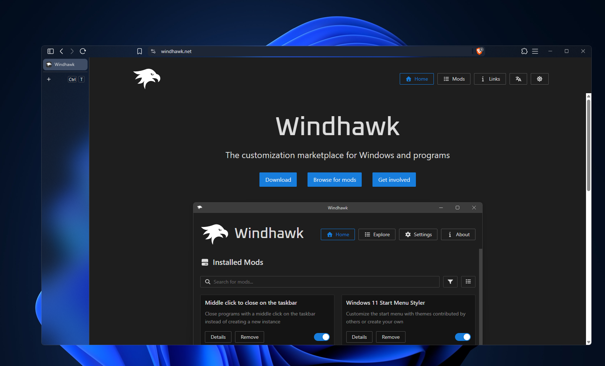

# Brave Acrylic

**Your browser, with a little more desktop.**

[Fast setup](#fast-setup) · [Custom themes](#advanced-setup) · [How it works](#how-it-works) · [Troubleshooting](#troubleshooting)

Brave Acrylic makes selected toolbar and vertical-tab backgrounds transparent so the desktop backdrop shows through. Regular, private, and Tor windows are checked against their own themes, so blue, purple, and pink windows can work together.

> **Alpha software.** This mod is still being tested and may need fixes after Brave updates. **[Translucent Windows](https://windhawk.net/mods/translucent-windows) is required** and must be enabled for `brave.exe` to provide the background effect.

## Requirements

- **x64 version of Brave**.
- [Windhawk](https://windhawk.net/) with **Brave Acrylic** enabled.
- The **[Translucent Windows](https://windhawk.net/mods/translucent-windows)** mod, configured to apply a translucent background effect to `brave.exe`.
- Windows **Transparency effects** enabled.

## Compatibility

- Tested on **Windows 11 26H2**, **Brave 1.98.60 / Chromium 156**, x64.
- **Windows 10 compatibility is unverified.** Brave Acrylic has no Windows 11 version gate, but the required backdrop must also work on the target system. Translucent Windows documents its SystemBackdrop modes as requiring Windows 11 22H2 or later; do not assume the full setup works on Windows 10.
- The per-window check has been tested with regular, private, and Tor window themes.
- Native ARM64 and 32-bit Brave are not supported. Unsupported native processes are refused before any hooks are installed.

**This is an alpha release, not a guarantee of future Brave compatibility.** The resolver tolerates changing relocation addresses and validates cached function boundaries, but it still works with private Brave functions. If local function discovery fails, exact-build compatibility data may restore it after a normal restart. If the functions or named-color table cannot be validated, transparency stays disabled.

## Fast setup

1. Enable **Brave Acrylic** and the required **Translucent Windows** mod. In Translucent Windows, apply the background effect you want to `brave.exe`.
2. Open `brave://settings/appearance`, select **Dark** appearance, and choose the built-in **Blue** theme.
3. Enable **vertical tabs** for the layout in the screenshot.
4. Close all Brave windows normally and reopen Brave.

The default **Hide duplicate Windows buttons** option removes Windows' underlying caption buttons while keeping Brave's own controls. Turn it off in the mod settings to restore the native layer.

### Install from source

Open [brave-acrylic.wh.cpp](brave-acrylic.wh.cpp), choose **Raw**, and copy the source. In Windhawk, open **Create a new mod**, replace the editor contents with that source, then compile and install it. No additional headers or DLLs are needed.

## Advanced setup

### Choose your own colors

To make an area of Brave's interface transparent, pick that area color and add that HEX value to **Colours to make transparent** in the mod's Settings tab.

The list matches **colors across Brave's native interface**. When a listed color appears elsewhere in an enabled window theme, that matching color also becomes transparent. For example, adding a sidebar's color can also affect a toolbar, button, or icon that uses exactly the same color. Add colors carefully: a common color such as pure white can also remove text.

1. Temporarily disable **Brave Acrylic** and close all Brave windows normally. Reopen Brave so you can sample its original, opaque colors.
2. On Windows 11, press **Win+Shift+S** (or **Print Screen / PrtSc** if configured to open Snipping Tool). Select the **Color picker** eyedropper and choose **HEX**.
3. For a new theme, sample the **main toolbar** first, then sample each additional area you want to make transparent. Pick a flat background area, away from text, icons, borders, shadows, and hover effects.
4. Open **Windhawk → Brave Acrylic → Settings → Colours to make transparent**. Add each sampled color on its own row, such as `333C4D` or `#333C4D`.
5. Save the settings, enable the mod, and close all Brave windows normally before reopening Brave to apply the colors.

See [Microsoft's Snipping Tool color picker instructions](https://blogs.windows.com/windowsexperience/2025/07/22/windows-11-is-the-home-for-ai-on-the-pc-with-even-more-experiences-available-today/#:~:text=To%20try%20color%20picker). If Color picker is unavailable in your Snipping Tool version, sample a screenshot with another color picker.

Use the **original color with the mod disabled**. A color sampled while acrylic is active is already blended with the backdrop and may not match Brave's paint color.

Each value must contain six hexadecimal digits (`RRGGBB`), with an optional leading `#` and no alpha channel. Matching is exact. Up to **16 colors** are supported. An empty list restores the built-in defaults. Invalid rows are reported in the log and skipped; later valid rows are still used.

Fresh installations include these colors for the built-in Dark + Blue theme:

| Default color | Area |
| --- | --- |
| `333C4D` | Vertical tab strip |
| `1D2636` | Main toolbar |

### Blue, purple, and pink together

Keep the blue theme's entries and add the original toolbar and sidebar colors for a purple private window or a pink Tor window. Each window uses its own native color provider, so enabling one theme does not blindly clear another window's background.

An unlisted toolbar color keeps that palette's normal background painting. There are no hardcoded purple or pink presets: private and Tor windows use the same check as ordinary windows.

### Restart after changing colors

Restart Brave normally after enabling, disabling, or changing the mod. Brave caches brushes and opacity information when windows are created. Saving new colors does not rebuild every cached surface. Close **all** Brave windows normally and reopen Brave. If Brave is configured to keep running in the background, exit that background instance normally as well.

### Recovery after Brave updates

**Download compatibility data after Brave updates** is enabled by default. Working builds use local detection or their existing cache without a network request. If function detection fails, a single background check looks for a **256-byte file for the exact installed Brave build** on this repository's `compatibility-v1` branch.

The mod checks the build identity, executable function boundaries, code fingerprints, and toolbar-color table before saving the file in Windhawk storage. **Restart all Brave windows normally after a successful download** to apply it. The cached data then works offline. Missing or invalid data leaves transparency disabled; it never falls back to another build's addresses.

GitHub Actions handles the large official symbol downloads. Your PC does not download PDBs or updated executable code. Disable the setting to prevent compatibility network checks; valid cached data remains usable. A changed calling convention, removed function, or different painting behavior can still require a mod update.

### Blur, tint, and backdrop

Use the required **Translucent Windows** mod to choose the background effect and tint for `brave.exe`. Brave Acrylic selects which original browser colors become transparent; Translucent Windows supplies the backdrop visible through them.

These are different controls: the color list selects paint to remove, while the backdrop settings control what you see behind it.

### Diagnostics

Turn on **Log colours (diagnostics)** in the mod's Settings tab to report original color IDs and RGB values. Capture them through Windhawk’s **Advanced → Debug logging → Detailed debug logs → Show log output**, then turn diagnostics off again.

Settings and the signature cache use Windhawk’s own storage. No separate configuration file or administrator access is needed to edit the mod settings.

The [advanced reference](docs/advanced.md) explains theme detection, log collection, startup behavior, and cache validation.

## How it works

1. **Find three native drawing functions.** A loader hook initializes the mod when `chrome.dll` is loaded, before Brave's caller starts using it. The resolver scans actual x64 function entries, with one unique match required for each function. Two private functions are hooked: color lookup and background painting. A third, canvas clearing, is called directly. There is no startup polling thread. A validated exact-build compatibility cache can supply the same three addresses when compiled patterns change.
2. **Discover the toolbar color ID.** It finds `kColorToolbar` in Brave's own named-color tables. The enum number is discovered rather than fixed in the mod, and duplicate definitions must agree.
3. **Check the original palette for each window.** The window's native color provider supplies its original toolbar color. An unmatched or unavailable palette keeps its original background painting.
4. **Remove matching paint and clear old pixels.** Exact listed opaque colors become transparent. During each native background paint, the mod tracks whether an eligible color was replaced. If so, it clears that background after the original painter returns, removing cached pixels before Brave draws the foreground. Nested paints keep separate state.
5. **Keep one set of window buttons.** For unowned, resizable Chromium browser frames, the optional caption fix hides Windows' underlying buttons. Brave retains its logical window style so its controls and fullscreen restoration continue to work. Turning the option or mod off restores the native buttons. Popups, owned dialogs, and tool windows are excluded.
6. **Let Translucent Windows supply the backdrop.** The caption fix leaves sizing and fullscreen frame bits alone. Translucent Windows controls the backdrop. The GPU hook only adjusts compatible RGBA composition surfaces; HWND, YUV, and protected-video surfaces keep their original settings.

Function addresses and the toolbar table entry are cached in Windhawk’s per-mod storage for the matching `chrome.dll` build and rechecked before use. Optional compatibility checks run on a separate worker only after local detection fails; the worker saves data for the next restart and does not alter a live paint path. A valid cache avoids scanning the full named-color table again. There is no screenshot polling, webpage injection, or recurring full-module scan.

## Troubleshooting

| Symptom | What to check |
| --- | --- |
| No transparency | Enable **both mods**, apply Translucent Windows to `brave.exe`, choose Dark + built-in Blue, then restart Brave. |
| Two sets of minimize/maximize/close buttons | Enable **Hide duplicate Windows buttons** in this mod. |
| A window needs Windows' original controls | Disable **Hide duplicate Windows buttons** to restore the native layer immediately. |
| Private or Tor window stays opaque | Add that theme's **original main toolbar color** and any sidebar colors you want removed. An unmatched palette stays opaque deliberately. |
| Text or icons disappear | Remove the color that also matches those elements, then restart Brave. Avoid adding common foreground colors. |
| Effect stops after a Brave update | Collect [Windhawk debug output](docs/advanced.md#collect-logs) and include your exact Brave version in a bug report. |
| Old colors remain after saving settings | Exit every Brave window and any background instance normally, then reopen Brave. |

For a bug report, include Windows and Brave versions, the theme and window type, your color list, Translucent Windows settings, and steps to reproduce. Avoid sharing private browsing information in screenshots or logs.

## Credits and license

Created by [bardelyne](https://github.com/bardelyne) with AI assistance. Built for [Windhawk](https://windhawk.net/). The required [Translucent Windows](https://windhawk.net/mods/translucent-windows) mod provides the backdrop shown in the screenshot. Brave and Chromium provide the native UI and color-provider functions this mod works with.

[MIT license](LICENSE).
